# 🧠 NeuroRadReporter

**AI-powered neuroradiology structured report generator**

🌐 **Live at: https://Radiology4U.github.io/NeuroRadReporter/**

> ⚠️ **For research and educational purposes only.** Not CE marked. Not for clinical patient care decisions without expert radiologist review.

---

## Features

| | |
|---|---|
| 🖥️ **DICOM viewer** | Drag & drop, scroll slices, window/level, zoom, 5 presets |
| 📂 **Accumulative loading** | Drop files across multiple turns — images accumulate, not reset |
| 🔒 **Anonymisation** | HIPAA §164.514 — SHA-256 patient IDs, year-only DOB, no PHI in AI context |
| 🖼️ **AI preprocessing** | Percentile windowing + CLAHE + two-pass tiling for maximum lesion visibility |
| 🔍 **Scan protocol** | Mandatory 13-region anatomical survey forces systematic AI analysis |
| 📚 **RAG context** | PubMed (live) + 50 curated Radiopaedia cases injected into every report |
| 📄 **Structured reports** | TECHNIQUE / FINDINGS / IMPRESSION / URGENCY auto-filled from AI output |
| 📤 **Export** | Plain text · HL7 FHIR R4 DiagnosticReport · PACS push (Orthanc/DICOMweb) · Audit CSV |

---

## AI Pipeline

```mermaid
flowchart TD
    A["📂 File Ingestion\nDICOM · PNG · JPEG · TIFF\nDrag & drop / browse\nMax 1000 files/drop"] --> B

    B["🔬 Parsing\nDICOM: tag walk, pixelData offset,\nrescaleSlope/Intercept, seriesUID\nRaster: PNG/JPEG img · TIFF via UTIF.js"] --> C

    C["🔒 Anonymisation\nanonPID = SHA-256(patientName) → 'Patient-3A7F'\nanonDOB = year only · anonDate = year+month\nRaw pixels stay in memory only"] --> D

    D["📋 Series Grouping & Viewer\nbuildSeriesTable → seriesGroups\nChip panel per series · ☑ = include in AI\nW/L: CT uses DICOM tags · MRI uses p2–p98"] --> E

    E["🖼️ AI Preprocessing\nStep A: per-slice percentile windowing p0.5–p99.5\n(background-excluded histogram)\nStep B: CLAHE — 8×8 tiles · clip 3.0 · bilinear interp\nStep C: two-pass tile construction"] --> F

    F["🗂️ Two-Pass Tiling\nPass 1 — Survey: 4×4 grid · 192px/cell · ≤38 tiles\n→ MRI: lossless PNG · CT: JPEG 88%\nPass 2 — Full-res crops: 4 key slices ≤512px PNG · MRI only"] --> G

    G["📚 RAG Context\nPubMed NCBI eutils: top 3 PMIDs\nRadiopaedia: 50 curated cases · keyword match\nAppended to system prompt"] --> H

    H["🤖 Claude Vision API\nPOST /v1/messages\nsystem: scan protocol + RAG\nuser: survey tiles + full-res crops + text prompt\nAPI key from localStorage only"] --> I

    I["🔍 Mandatory Scan Protocol\nStep 1: 13-region parenchyma survey\nFrontal · Parietal · Temporal+hippocampi\nOccipital · Insula · BG · Thalami · IC\nCorona radiata · CC · Brainstem · Cerebellum\nStep 2: signal characterisation — DWI/ADC/FLAIR concordance\nStep 3: extra-axial + vascular\nStep 4: conclusion LAST"] --> J

    J["📄 Structured Report Output\nAuto-fill: TECHNIQUE / FINDINGS / IMPRESSION / URGENCY\nDifferential ranking\nExport: TXT · HL7 FHIR R4 · PACS · Audit CSV"]

    style A fill:#1c2f4a,stroke:#58a6ff,color:#e6edf3
    style B fill:#2a1f3d,stroke:#d2a8ff,color:#e6edf3
    style C fill:#3d2a1f,stroke:#ffa657,color:#e6edf3
    style D fill:#1f3d25,stroke:#7ee787,color:#e6edf3
    style E fill:#3d1f1f,stroke:#f78166,color:#e6edf3
    style F fill:#3d1f1f,stroke:#f78166,color:#e6edf3
    style G fill:#1c2f3d,stroke:#79c0ff,color:#e6edf3
    style H fill:#3d2f1a,stroke:#e3b341,color:#e6edf3
    style I fill:#3d1f1f,stroke:#ff7b72,color:#e6edf3
    style J fill:#1f3d25,stroke:#56d364,color:#e6edf3
```

### Pipeline Detail

#### 1 — File Ingestion (Accumulative)
- Each drop event **appends** to the existing study — images never reset unless you click "Clear all"
- De-duplication by `seriesUID + instanceNumber + filename` prevents doubles
- Supports DICOM (`.dcm`, extensionless), PNG, JPEG, multi-page TIFF (via UTIF.js)

#### 2 — DICOM / Raster Parsing
- Full tag walk over groups `0008 / 0010 / 0018 / 0020 / 0028`
- Extracts `rescaleSlope`, `rescaleIntercept`, `bitsAllocated`, `pixelRepresentation`, `isCT`
- Raster images wrapped as synthetic DICOM-like slice objects

#### 3 — Anonymisation (HIPAA §164.514)
- `anonPID()` — SHA-256 hash of patient name, truncated to 4 hex chars → `"Patient-3A7F"`
- Date of birth reduced to year; study dates to year + month
- **Raw pixel data and original tags never leave the browser** — only anonymised strings reach the AI and audit log
- Multi-patient studies detected and flagged with ⚠ in the AI context

#### 4 — Series Grouping & Viewer
- `buildSeriesTable()` groups slices by `seriesUID`, sorted by `seriesNum → instanceNumber`
- Series chip panel lets you toggle which series the AI receives
- Window/Level: CT reads DICOM `WindowCenter/Width` tags; MRI uses percentile windowing
- Mouse drag adjusts W/L in real time

#### 5 — AI Image Preprocessing

**Why this matters:** min/max windowing crushes DWI/FLAIR lesions (covering <5% of image) into noise. Three layers fix this:

| Layer | What it does |
|---|---|
| **Percentile windowing** | Full histogram scan → exclude background pixels (below 5% of mean) → p0.5–p99.5 per slice |
| **CLAHE** | 8×8 tile grid, clip limit 3.0, bilinear interpolation — boosts local contrast without amplifying noise |
| **Two-pass tiling** | Pass 1: survey grid (4×4, 192 px/cell, ≤38 tiles); Pass 2: 4 full-resolution key slices ≤512 px PNG (MRI only) |

#### 6 — RAG Context
- **PubMed** — live NCBI eutils search for top 3 relevant PMIDs → title, journal, year
- **Radiopaedia** — 50 curated neuroradiology cases matched by keyword, zero HTTP calls

#### 7 — Claude Vision API
- `POST https://api.anthropic.com/v1/messages`
- Survey tiles + full-res crops passed as base64 PNG/JPEG in `messages[].content`
- API key read from `localStorage` — **never hardcoded**

#### 8 — Mandatory Scan Protocol
The system prompt enforces a **4-step chain-of-thought** before any conclusion is written:

1. **Parenchyma survey** — 13 regions checked explicitly (L and R separately): frontal, parietal, temporal + hippocampi, occipital, insula, basal ganglia, thalami, internal capsule, corona radiata, corpus callosum, brainstem, cerebellum
2. **Signal characterisation** — bright/dark, focal/diffuse, DWI↑↓ / ADC↑↓ / FLAIR↑↓, true restriction vs T2 shine-through
3. **Extra-axial & vascular** — sulci, ventricles, dural sinuses
4. **Conclusion last** — TECHNIQUE / FINDINGS / IMPRESSION / URGENCY written only after steps 1–3

This prevents the AI from doing gestalt pattern matching and skipping over subtle lesions.

#### 9 — Structured Report Output
- Regex auto-fills form fields from AI response
- One-click export: plain text, HL7 FHIR R4 `DiagnosticReport` JSON, PACS push, audit CSV

---

## Usage

1. Open the [live app](https://Radiology4U.github.io/NeuroRadReporter/)
2. Enter your Anthropic API key (stored in browser `localStorage` only)
3. Drag & drop DICOM files or images — repeat to add more series
4. Select which series to include via the chip panel
5. Click **Generate AI Report**

---

## Technical Stack

- **Single-file static HTML** — no build step, no server, no dependencies to install
- **Deployed** via GitHub Pages + GitHub Actions CI/CD
- **DICOM parsing** — pure JavaScript, no server-side processing
- **TIFF support** — [UTIF.js](https://github.com/photopea/UTIF.js)
- **AI** — [Claude](https://www.anthropic.com/claude) vision API (Anthropic)

---

## Security

- API key stored in `localStorage` only — never in source code, never transmitted anywhere except the Anthropic API
- All image processing and anonymisation happen **client-side in the browser**
- No patient data is stored, logged or transmitted beyond the AI API call (which uses anonymised IDs)
- Audit log written to browser memory only; exported CSV contains anonymised IDs

---

## Disclaimer

This tool is intended for **research and educational purposes only**.  
It is **not a medical device**, is not CE marked, and must not be used as a substitute for radiologist review in clinical practice.
